[🇧🇷 Português](./README.pt-BR.md) &nbsp;|&nbsp; 🇺🇸 English

 

# Kauã Martins

### Software Developer · ERP Systems, Backend & AI-Powered Tools

*Building reliable systems where data integrity and clean architecture actually matter.*

 

 

---

## About Me

I'm a developer intern at **CI&T**, in the **NextGen AI** program, since November 2026.

Before that, I spent a year at **MSI Soluções** building and supporting ERP systems used in production by real clients — the kind of environment where a bad migration or a wrong `JOIN` shows up as someone's operation stopping on a Monday morning. That meant writing stored procedures and views in PostgreSQL, building REST APIs, maintaining React Native applications for warehouse and logistics operations, and occasionally going into Delphi or Crystal Reports to fix something that had been running for over a decade. It's a mix that forces you to think about both the elegance of a solution and whether it will actually survive contact with production data.

What I care about most is the layer underneath the UI: database design, query performance, and API architecture that doesn't fall apart the moment requirements change. I'm as comfortable debugging a recursive SQL view at 6pm as I am building a new mobile screen from scratch the next morning.

Now I'm pushing that same engineering mindset into **AI-powered software**: agents, RAG, fine-tuning and evals — treating LLM systems like any other system, with clear boundaries, guardrails, and measured results instead of vibes.

I also freelance: I maintain and extend a discount-club platform running in production for a real client.

 

---

## Tech Stack

 

**Languages**

  

**Frameworks**

  

**Backend & Mobile**

Node.js · NestJS · REST APIs · React Native · Delphi · Crystal Reports

  

**Databases**

PostgreSQL · Stored Procedures · Views · Query Optimization · pgvector

  

**AI & LLM**

LLM APIs · Prompt Engineering · RAG · Embeddings · Tool Calling · Agent Orchestration · Evaluation · Fine-tuning (Hugging Face Transformers) · scikit-learn

  

**Tools**

  

**AI Tools**

 

---

## Current Focus

| Area | Focus |
|:--|:--|
| 🤖 **AI Engineering** | Building LLM-powered features: RAG, tool calling, and evaluated agents |
| 🧠 **Machine Learning** | Fine-tuning small models and competing on Kaggle |
| 🚀 **Freelance Products** | Shipping features to platforms running in production |
| 🔌 **API Development** | Designing clean, maintainable REST services |
| 🏗️ **Software Architecture** | Structuring systems that scale without becoming fragile |
| 🐘 **PostgreSQL** | Query optimization, views, and stored procedure design |

 

---

## 🤖 AI Lab — Building in Public

I'm documenting my AI work the same way I'd ship anything else: scoped problem, working demo, and numbers you can check.

| Project | What it does | Status |
|:--|:--|:--|
| [**Delivery Agent**](https://github.com/Kaua-Martins-Santos/delivery-agent) | Multi-tenant customer-service agent for delivery stores — RAG over each store's knowledge base, tool calling for real lookups, and an eval suite | 🚧 In progress |
| [**RAG for HR**](https://github.com/Kaua-Martins-Santos/rag-rh-gemini) | HR policy chatbot with Gemini — embeddings + cosine similarity, answers only from context and says "not found" otherwise; compares answers with and without RAG | ✅ Done |
| [**Synthetic Data for Fraud**](https://github.com/Kaua-Martins-Santos/genai-dados-sinteticos-fraude) | Gemini few-shot generation of synthetic fraud rows for a dataset with 0.17% fraud — fraud-class F1 0.69 → 0.73, with limits documented | ✅ Done |
| [**Complaint Classifier**](https://huggingface.co/Martinsk123) | BERTimbau fine-tuned to classify complaint reasons in Olist e-commerce reviews, with training labels generated by Gemini — published on Hugging Face | 🚧 In progress |
| [**Kaggle Competitions**](https://www.kaggle.com/martinskaua) | LLM Classification Finetuning (predicting human preference on Chatbot Arena) and Titanic | 🚧 In progress |
| **Clinic Assistant (RAG)** | Internal assistant answering clinic staff questions over clinic data — pgvector retrieval, tool calling for live schedule lookups, and a 50-question evaluation set | 🚧 In progress |
| **Text-to-SQL with Guardrails** | Natural language to read-only SQL over a sample schema, with query validation and safety limits | 📋 Planned |

 

---

## Contribution Graph

<picture>
<source media="(prefers-color-scheme: dark)" srcset="https://raw.githubusercontent.com/Kaua-Martins-Santos/Kaua-Martins-Santos/output/pacman-contribution-graph-dark.svg">
<source media="(prefers-color-scheme: light)" srcset="https://raw.githubusercontent.com/Kaua-Martins-Santos/Kaua-Martins-Santos/output/pacman-contribution-graph.svg">

</picture>

generated with <a href="https://abozanona.github.io/pacman-contribution-graph/">abozanona/pacman-contribution-graph</a>

 

---

## Featured Projects

<table>
<tr>
<td width="50%" valign="top">

### 🏷️ EuPlus — Discount Club (Freelance)

Subscription discount club running in production. I took over the platform from another developer, moved repo, hosting and database to the client's accounts, and shipped a partner self-signup portal, a product catalog with member-only prices, and an order flow that notifies the partner on WhatsApp.

**Stack:** `React 19` · `TypeScript` · `Vite` · `Tailwind` · `Netlify Functions` · `PostgreSQL (Neon)`

</td>
<td width="50%" valign="top">

### 📡 Remote Server Monitoring (ERP)

Remote monitoring for the servers of the ERP's client companies, with no new infrastructure: a PL/Python function inside PostgreSQL collects 5 indicators (last backup, disk space, active users, system version, scheduled-job status via pg_timetable), logs in to the existing internal API with JWT and sends everything to a central database.

**Stack:** `PostgreSQL` · `PL/Python` · `pg_timetable` · `REST API` · `JWT`

</td>
</tr>
<tr>
<td width="50%" valign="top">

### 🏥 VivaCare — Clinic SaaS

Multi-tenant SaaS for clinic management — scheduling, digital patient records, billing via Stripe, a per-clinic WhatsApp bot, and isolated environments per clinic on a single instance. I ran a full security audit that found a data leak between tenants in the owner dashboard, and fixed the isolation.

**Stack:** `Next.js 15` · `TypeScript` · `Prisma` · `PostgreSQL` · `Stripe` · `AWS S3`

 

</td>
<td width="50%" valign="top">

### 🌍 NationForge

Multiplayer nation simulator in a persistent world — players manage population, economy, resources and diplomacy. Built in documented phases, with httpOnly cookie sessions and e2e tests.

**Stack:** `NestJS` · `Next.js` · `Prisma` · `PostgreSQL` · `JWT`

</td>
</tr>
<tr>
<td width="50%" valign="top">

### 🎫 Ticket System — UNASP

Web-based maintenance ticketing system replacing spreadsheet tracking. Real-time status, BI dashboard with Recharts, tool-loan tracking, photo capture, and a public portal for opening tickets without login.

**Stack:** `Next.js 14` · `TypeScript` · `PostgreSQL` · `Recharts`

</td>
<td width="50%" valign="top">

### 📦 Inventory Management System

Full inventory control system replacing unreliable spreadsheets — asset and consumable tracking, loan history, JWT authentication, admin panel, and audit-ready reporting.

**Stack:** `Next.js 14` · `TypeScript` · `Prisma` · `PostgreSQL` · `JWT`

</td>
</tr>
<tr>
<td width="50%" valign="top">

### 🍽️ Salsa — Restaurant POS System

Complete restaurant management system: orders, cash register, inventory, sales history, and analytics dashboard. Built as a sellable desktop product with remote license validation via API.

**Stack:** `Python` · `Flet` · `SQLite`

</td>
<td width="50%" valign="top">

### 🎮 Save Point — Hackathon

Gamified check-in system built during the Savepoint Hackathon. Visitors identify by phone number, earn coins per visit, level up, and form guilds — with real-time individual and guild rankings.

**Stack:** `React` · `Vite` · `Node.js` · `Express`

</td>
</tr>
<tr>
<td width="50%" valign="top">

### 🗓️ Minimalist Planner

100% offline desktop productivity app — kanban, calendar, task lists, and PDF report generation. Local SQLite storage, distributed as a standalone executable with no account or subscription required.

**Stack:** `Electron` · `React` · `SQLite` · `Vite`

</td>
<td width="50%" valign="top">

### 🕹️ Pixel Office

Pixel-art dashboard that turns running AI coding sessions into little characters moving around an office — wired up through local hooks.

**Stack:** `HTML` · `JavaScript` · `Pixel Art`

</td>
</tr>
<tr>
<td width="50%" valign="top">

### 🎮 Motion Console — Phone as Controller

Wii-style motion game console in the browser: the game runs on the PC and up to 4 phones become motion controllers using their own sensors — no app to install.

**Stack:** `Web` · `Phone sensors` · `Local multiplayer`

</td>
<td width="50%" valign="top">

### 🌱 Smart Garden — IoT

University team project: an ESP32 garden with sensors that controls irrigation, plus a web dashboard. I worked on architecture docs (RFC and ADRs), irrigation flowcharts, the test strategy, and automated tests.

**Stack:** `ESP32` · `React` · `Vite` · `Vitest`

</td>
</tr>
</table>

See the full list of projects on my <a href="https://kaua-exe-portifolio.vercel.app">interactive portfolio</a>

 

---

## Contact

Always open to a conversation about engineering, architecture, or new opportunities.

 

---

<i>"Great software isn't just code — it's solving problems that matter."</i>

