🇧🇷 Português &nbsp;|&nbsp; [🇺🇸 English](./README.md)

 

# Kauã Martins

### Desenvolvedor de Software · Sistemas ERP, Backend & Ferramentas com IA

*Construindo sistemas confiáveis, onde integridade de dados e arquitetura limpa realmente importam.*

 

 

---

## Sobre mim

Sou estagiário de desenvolvimento na **CI&T**, no programa **NextGen AI**, desde novembro de 2026.

Antes disso, passei um ano na **MSI Soluções** construindo e dando suporte a sistemas ERP usados em produção por clientes reais — o tipo de ambiente onde uma migração mal feita ou um `JOIN` errado vira a operação de alguém parada numa segunda-feira de manhã. Isso significava escrever stored procedures e views em PostgreSQL, construir APIs REST, manter aplicações React Native para operações de logística e armazém, e eventualmente entrar em Delphi ou Crystal Reports para corrigir algo que rodava havia mais de dez anos. É uma combinação que obriga a pensar tanto na elegância de uma solução quanto na sua capacidade de sobreviver ao contato com dados reais de produção.

O que mais me interessa é a camada abaixo da interface: modelagem de banco de dados, performance de queries e arquitetura de API que não desmorona assim que os requisitos mudam. Fico igualmente à vontade depurando uma view SQL recursiva às 18h e construindo uma tela mobile do zero na manhã seguinte.

Agora estou levando essa mesma mentalidade de engenharia para **software com IA**: agentes, RAG, fine-tuning e evals — tratando sistemas com LLM como qualquer outro sistema, com limites claros, guardrails e resultados medidos em vez de "achismo".

Também trabalho como freelancer: mantenho e evoluo uma plataforma de clube de descontos rodando em produção para um cliente real.

 

---

## Tech Stack

 

**Linguagens**

  

**Frameworks**

  

**Backend & Mobile**

Node.js · NestJS · APIs REST · React Native · Delphi · Crystal Reports

  

**Bancos de dados**

PostgreSQL · Stored Procedures · Views · Otimização de Queries · pgvector

  

**IA & LLM**

APIs de LLM · Engenharia de Prompt · RAG · Embeddings · Tool Calling · Orquestração de Agentes · Avaliação (Evals) · Fine-tuning (Hugging Face Transformers) · scikit-learn

  

**Ferramentas**

  

**Ferramentas de IA**

 

---

## Foco Atual

| Área | Foco |
|:--|:--|
| 🤖 **Engenharia de IA** | Funcionalidades com LLM: RAG, tool calling e agentes com avaliação |
| 🧠 **Machine Learning** | Fine-tuning de modelos pequenos e competições no Kaggle |
| 🚀 **Produtos Freelance** | Entregando funcionalidades em plataformas que rodam em produção |
| 🔌 **Desenvolvimento de APIs** | Serviços REST limpos e fáceis de manter |
| 🏗️ **Arquitetura de Software** | Sistemas que crescem sem ficar frágeis |
| 🐘 **PostgreSQL** | Otimização de queries, views e stored procedures |

 

---

## 🤖 Laboratório de IA — Construindo em Público

Documento meu trabalho com IA do mesmo jeito que entregaria qualquer outra coisa: problema bem definido, demo funcionando e números que dá para conferir.

| Projeto | O que faz | Status |
|:--|:--|:--|
| [**Delivery Agent**](https://github.com/Kaua-Martins-Santos/delivery-agent) | Agente de atendimento multi-tenant para lojas de delivery — RAG sobre a base de conhecimento de cada loja, tool calling para consultas reais e suíte de evals | 🚧 Em andamento |
| [**RAG para RH**](https://github.com/Kaua-Martins-Santos/rag-rh-gemini) | Chatbot de políticas de RH com Gemini — embeddings + similaridade de cosseno, responde só com o contexto e diz "não encontrei" quando não sabe; compara respostas com e sem RAG | ✅ Concluído |
| [**Dados Sintéticos para Fraude**](https://github.com/Kaua-Martins-Santos/genai-dados-sinteticos-fraude) | Geração few-shot de fraudes sintéticas com Gemini para um dataset com 0,17% de fraudes — F1 da classe fraude de 0,69 para 0,73, com limitações documentadas | ✅ Concluído |
| [**Classificador de Reclamações**](https://huggingface.co/Martinsk123) | BERTimbau com fine-tuning para classificar o motivo de reclamações em avaliações de e-commerce da Olist, com rótulos de treino gerados pelo Gemini — publicado no Hugging Face | 🚧 Em andamento |
| [**Competições Kaggle**](https://www.kaggle.com/martinskaua) | LLM Classification Finetuning (prever a preferência humana no Chatbot Arena) e Titanic | 🚧 Em andamento |
| **Assistente para Clínicas (RAG)** | Assistente interno que responde dúvidas da equipe da clínica sobre os dados dela — busca com pgvector, tool calling para consultar a agenda em tempo real e um conjunto de avaliação com 50 perguntas | 🚧 Em andamento |
| **Text-to-SQL com Guardrails** | Linguagem natural para SQL somente leitura sobre um schema de exemplo, com validação de query e limites de segurança | 📋 Planejado |

 

---

## Gráfico de Contribuições

<picture>
<source media="(prefers-color-scheme: dark)" srcset="https://raw.githubusercontent.com/Kaua-Martins-Santos/Kaua-Martins-Santos/output/pacman-contribution-graph-dark.svg">
<source media="(prefers-color-scheme: light)" srcset="https://raw.githubusercontent.com/Kaua-Martins-Santos/Kaua-Martins-Santos/output/pacman-contribution-graph.svg">

</picture>

gerado com <a href="https://abozanona.github.io/pacman-contribution-graph/">abozanona/pacman-contribution-graph</a>

 

---

## Projetos em Destaque

<table>
<tr>
<td width="50%" valign="top">

### 🏷️ EuPlus — Clube de Descontos (Freelance)

Clube de descontos por assinatura rodando em produção. Assumi a plataforma de outro desenvolvedor, passei repositório, hospedagem e banco para as contas do cliente e entreguei um portal de autocadastro de parceiros, catálogo de produtos com preço exclusivo para assinantes e um fluxo de pedidos que avisa o parceiro pelo WhatsApp.

**Stack:** `React 19` · `TypeScript` · `Vite` · `Tailwind` · `Netlify Functions` · `PostgreSQL (Neon)`

</td>
<td width="50%" valign="top">

### 📡 Monitoramento Remoto de Servidores (ERP)

Monitoramento remoto dos servidores das empresas clientes do ERP, sem infraestrutura nova: uma função PL/Python dentro do PostgreSQL coleta 5 indicadores (último backup, espaço em disco, usuários ativos, versão do sistema e status dos jobs agendados via pg_timetable), faz login com JWT na API interna que já existia e envia tudo para um banco central.

**Stack:** `PostgreSQL` · `PL/Python` · `pg_timetable` · `API REST` · `JWT`

</td>
</tr>
<tr>
<td width="50%" valign="top">

### 🏥 VivaCare — SaaS para Clínicas

SaaS multi-tenant para gestão de clínicas — agendamentos, prontuário digital, cobrança via Stripe, bot de WhatsApp por clínica e ambientes isolados por clínica numa única instância. Fiz uma auditoria de segurança completa que encontrou um vazamento de dados entre tenants no dashboard do dono e corrigi o isolamento.

**Stack:** `Next.js 15` · `TypeScript` · `Prisma` · `PostgreSQL` · `Stripe` · `AWS S3`

 

</td>
<td width="50%" valign="top">

### 🌍 NationForge

Simulador multiplayer de nações em um mundo persistente — os jogadores administram população, economia, recursos e diplomacia. Construído em fases documentadas, com sessões em cookies httpOnly e testes e2e.

**Stack:** `NestJS` · `Next.js` · `Prisma` · `PostgreSQL` · `JWT`

</td>
</tr>
<tr>
<td width="50%" valign="top">

### 🎫 Sistema de Tickets — UNASP

Sistema web de chamados de manutenção que substituiu o controle por planilhas. Status em tempo real, dashboard BI com Recharts, controle de empréstimo de ferramentas, captura de fotos e portal público para abrir chamados sem login.

**Stack:** `Next.js 14` · `TypeScript` · `PostgreSQL` · `Recharts`

</td>
<td width="50%" valign="top">

### 📦 Gerenciador de Estoque

Sistema completo de inventário que substituiu planilhas pouco confiáveis — controle de ativos e consumíveis, histórico de empréstimos, autenticação JWT, painel admin e relatórios prontos para auditoria.

**Stack:** `Next.js 14` · `TypeScript` · `Prisma` · `PostgreSQL` · `JWT`

</td>
</tr>
<tr>
<td width="50%" valign="top">

### 🍽️ Salsa — Sistema para Restaurantes

Sistema completo de gestão para restaurantes: comandas, caixa, estoque, histórico de vendas e dashboard de métricas. Construído como produto desktop vendável, com validação de licença remota via API.

**Stack:** `Python` · `Flet` · `SQLite`

</td>
<td width="50%" valign="top">

### 🎮 Save Point — Hackathon

Sistema de check-in gamificado construído no Hackathon Savepoint. Visitantes se identificam pelo telefone, ganham moedas a cada visita, sobem de nível e formam guildas — com ranking individual e de guildas em tempo real.

**Stack:** `React` · `Vite` · `Node.js` · `Express`

</td>
</tr>
<tr>
<td width="50%" valign="top">

### 🗓️ Planner Minimalista

App desktop de produtividade 100% offline — kanban, calendário, listas de tarefas e relatórios em PDF. Dados salvos localmente em SQLite, distribuído como executável, sem conta e sem assinatura.

**Stack:** `Electron` · `React` · `SQLite` · `Vite`

</td>
<td width="50%" valign="top">

### 🕹️ Escritório Pixel

Painel em pixel art que transforma as sessões de agentes de código rodando na máquina em bonequinhos andando por um escritório — ligado por hooks locais.

**Stack:** `HTML` · `JavaScript` · `Pixel Art`

</td>
</tr>
<tr>
<td width="50%" valign="top">

### 🎮 Console de Movimento — Celular como Controle

Console de jogos por movimento estilo Wii no navegador: o jogo roda no PC e até 4 celulares viram controles usando os próprios sensores — sem instalar app.

**Stack:** `Web` · `Sensores do celular` · `Multiplayer local`

</td>
<td width="50%" valign="top">

### 🌱 Horta Inteligente — IoT

Projeto em equipe na faculdade: horta com ESP32 e sensores que controla a irrigação, com dashboard web. Trabalhei na documentação de arquitetura (RFC e ADRs), nos fluxogramas da irrigação, na estratégia de testes e nos testes automatizados.

**Stack:** `ESP32` · `React` · `Vite` · `Vitest`

</td>
</tr>
</table>

Veja a lista completa de projetos no meu <a href="https://kaua-exe-portifolio.vercel.app">portfólio interativo</a>

 

---

## Contato

Sempre aberto a uma conversa sobre engenharia, arquitetura ou novas oportunidades.

 

---

<i>"Software de qualidade não é só código — é resolver problemas que importam."</i>

